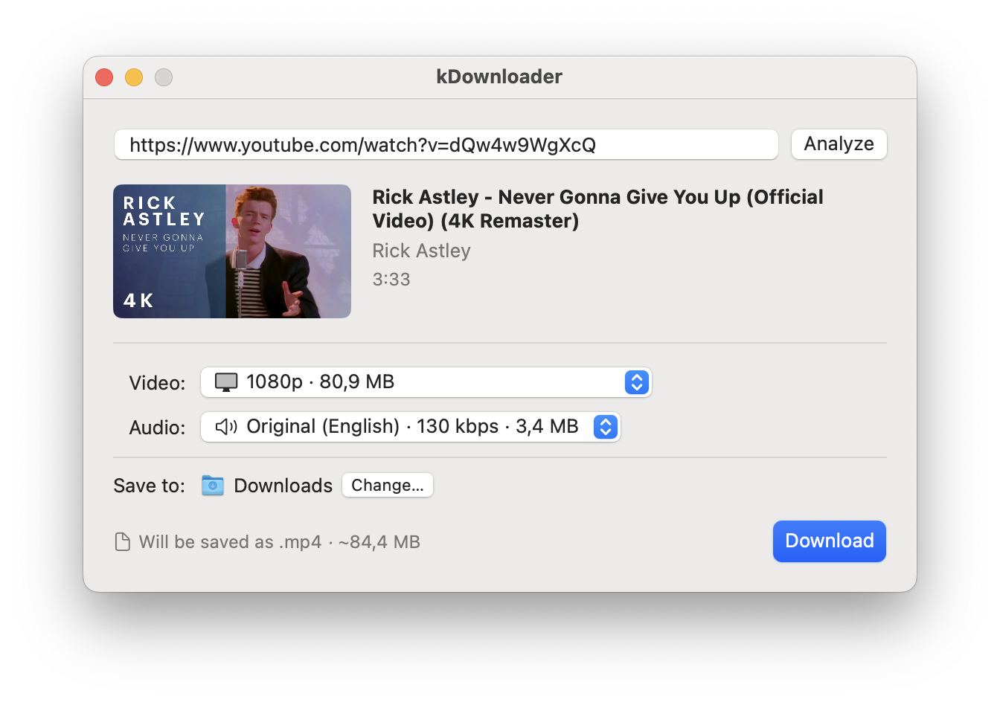

# kDownloader

A simple macOS app for downloading videos from YouTube and the
[other sites supported by yt-dlp](https://github.com/yt-dlp/yt-dlp/blob/master/supportedsites.md).
By default it saves a file that plays in QuickTime.



- macOS 14 or later, Apple Silicon only.
- English and Russian.
- yt-dlp, FFmpeg and Deno are bundled: nothing has to be installed with Homebrew.

Building the app or working on its code: see [DEVELOPMENT.md](DEVELOPMENT.md).

## Installing

1. Download `kDownloader-<version>.zip` from the
   [latest release](https://github.com/kozian/kDownloader/releases/latest), unzip
   it and move `kDownloader.app` to `/Applications`.
2. The app is not notarized by Apple, so macOS blocks its first launch. Remove the
   quarantine flag in Terminal:

   ```sh
   xattr -dr com.apple.quarantine /Applications/kDownloader.app
   ```

   Or try to open the app once, then click **Open Anyway** in
   **System Settings → Privacy & Security**.

## Downloading a video

Paste a link, choose the format, press **Download**. An existing file is never
overwritten. Playlists, channels and live streams are not supported.

## Choosing a format

| Video | Audio | Saved as | Plays on a Mac |
|---|---|---|---|
| H.264 or HEVC | AAC | `.mp4` | Everywhere, including QuickTime, Photos and iPhone |
| AV1 | AAC | `.mp4` | In QuickTime on a Mac with M3 or later |
| VP9, or any video with Opus audio | | `.mkv` | In a third-party player such as [IINA](https://iina.io) or [VLC](https://www.videolan.org/vlc/) |

By default the menus offer only the first row. The highest quality (on YouTube,
usually 4K) is often available only in VP9 or AV1: to get it, turn on
**Show all formats** in **Settings** (⌘,).

## Videos that need signing in

If a video is unavailable without signing in, kDownloader offers to use your
sign-in from a browser. You can turn this off in **Settings**. Cookies are never
stored or written to the log.

## Updating yt-dlp

If a site stops working, update yt-dlp: an icon next to **Analyze** shows that an
update is available, and **Settings → yt-dlp** installs it. **Use Bundled
Version** goes back to the version that came with the app.

## When something goes wrong

- To ask for help, send the log: **Window → Log → Export…**.
- A cancelled or failed download leaves partial files in the destination folder.

## Licenses

kDownloader's own code is released under the [MIT license](LICENSE). The app
bundles third-party tools under their own licenses:

| Component | License | Notes |
|---|---|---|
| [yt-dlp](https://github.com/yt-dlp/yt-dlp) | Unlicense | Its build includes Python, OpenSSL, mutagen (GPL-2.0+) and other components; their licenses and the maintainers' offer of their source are in its `THIRD_PARTY_LICENSES.txt`. |
| [FFmpeg](https://ffmpeg.org) (ffmpeg, ffprobe) | LGPL-2.1+ | Built from the official source without GPL or non-free parts. The source is attached to every release as `ffmpeg-<version>.tar.xz`. |
| [Deno](https://deno.com) | MIT | Deno embeds V8 (BSD-3-Clause) and Rust crates (mostly MIT / Apache-2.0); Deno does not publish their notices together, so only Deno's own license is included. |

The license texts are inside the app: **About kDownloader → Show Licenses in
Finder**. kDownloader runs these tools as separate programs; they are not linked
into its code, so their licenses do not extend to it.

Downloading may be restricted by a site's terms of use or by copyright. Download
only what you have the right to.
